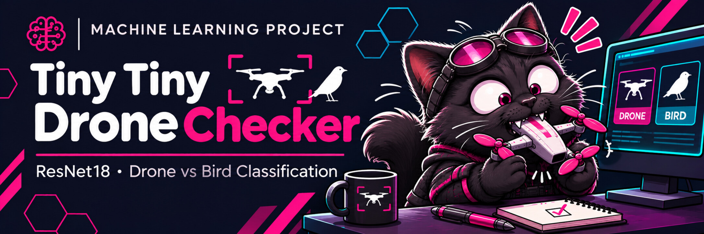
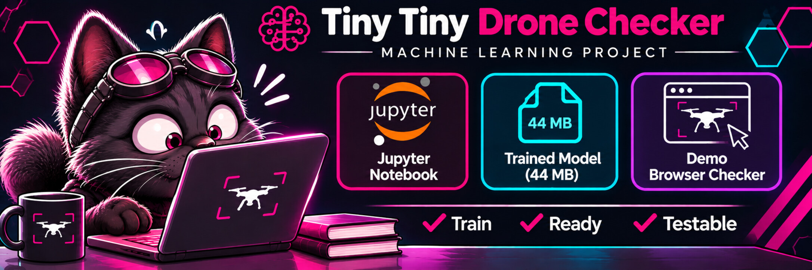
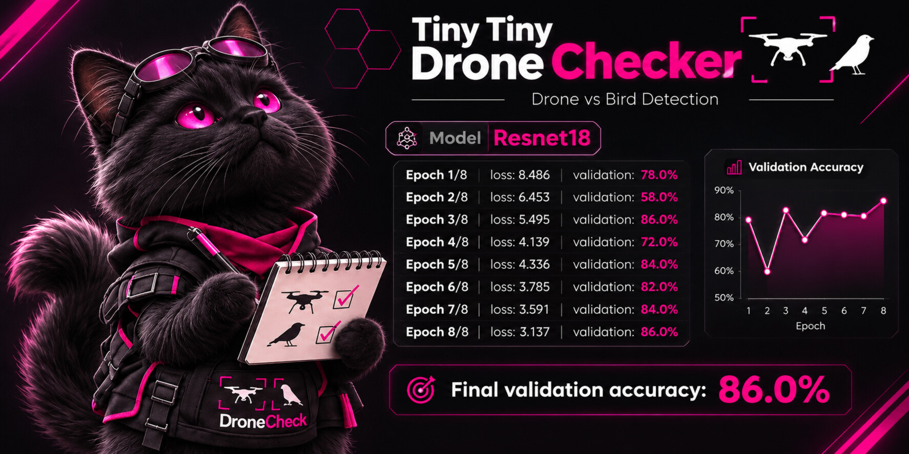
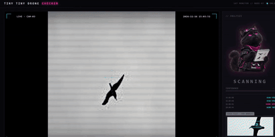

<p align="center">
  
</p>

# 🚁 Tiny Tiny Drone Checker

**Is that a drone or a bird? A tiny image classifier built with transfer learning on ResNet18**


This is a **tiny demo project**. It uses only a few samples (100 training images per class) and aims to show how a pre-trained **ResNet18** can be adapted with transfer learning to classify your own images, in this case telling a **drone** from a **bird** in the sky.

It's a very tiny, quick demo: my goal was to get it above **70% accuracy**, and all test runs scored **80%+**.

<p align="center">
  
</p>

## 📊 Results

| Model | Training images | Validation accuracy |
|---|---|---|
| Baseline (always guess one class) | – | 50% |
| ⭐ ResNet18, feature extraction (224×224) | 200 | ~84–88% |

With only 50 validation images, each image is worth 2%, so results vary a bit between runs.

<p align="center">
  
</p>

## 🗂️ Dataset

Images come from the [Drone vs Bird dataset on Kaggle](https://www.kaggle.com/datasets/muhammadsaoodsarwar/drone-vs-bird). A small, balanced subset is used:

| | bird | drone |
|---|---|---|
| train | 100 | 100 |
| val | 25 | 25 |

Each image was center-cropped to a square (80% of the shorter side), resized to 256×256 and lightly sharpened. Exact duplicates were removed, and edited copies of the same photo were kept in the same split, so the validation score is honest.

## ⚙️ How it works

- **Model:** ResNet18 pre-trained on ImageNet. The last layer is replaced with a new one for our 2 classes.
- **Feature extraction:** the pre-trained layers are frozen and only the new last layer is trained. 
- **Augmentation:** random crops and horizontal flips on the training images.
- **Training:** 10 epochs with the Adam optimizer and cross-entropy loss.
- **Saved model:** the weights, class names and image size are saved to `model/drone_check.pth`, which the web demo loads.

## 📓 About the notebook (.ipynb)

`notebook/DroneCheck.ipynb` contains the whole training process, step by step: settings → check the data → build the model → prepare the images → train and evaluate.

| Option | How |
|---|---|
| 👀 Just read it | Open `notebook/DroneCheck.ipynb` on GitHub. |
| 💻 Run it locally | `pip install torch torchvision jupyter`, then open the notebook and run the cells from top to bottom. |

Training runs fine on a CPU and takes a few minutes.

## 🧠 The model

The trained model is included in the repo: `model/drone_check.pth` (~45 MB). It holds the ResNet18 weights plus the class names and image size, so it can be loaded without the notebook.

**[⬇️ Download drone_check.pth](../../raw/main/model/drone_check.pth)**

To use it in your own Python code (`pip install torch torchvision pillow`):

```python
import torch, torch.nn as nn
from PIL import Image
from torchvision import models, transforms

checkpoint = torch.load("model/drone_check.pth", map_location="cpu")
model = models.get_model(checkpoint["architecture"], weights=None)
model.fc = nn.Linear(model.fc.in_features, len(checkpoint["classes"]))
model.load_state_dict(checkpoint["state_dict"])
model.eval()

transform = transforms.Compose([
    transforms.Resize(checkpoint["image_size"]),
    transforms.CenterCrop(checkpoint["image_size"]),
    transforms.ToTensor(),
    transforms.Normalize([0.485, 0.456, 0.406], [0.229, 0.224, 0.225]),
])

image = transform(Image.open("my_photo.jpg").convert("RGB")).unsqueeze(0)
with torch.no_grad():
    probs = torch.softmax(model(image), dim=1)[0]
best = probs.argmax().item()
print(checkpoint["classes"][best], f"{probs[best]:.1%}")
```

## 🎥 Web demo

<p align="center">
  
</p>

A small local web page that simulates a security camera watching the sky. It shows a random frame from `demo/camsim`, the model classifies it, and the DroneCheck cat reports **BIRD** or **DRONE** with a confidence score.

**Windows, one click:** double-click `demo/run.bat`.
On the first run it creates its own virtual environment in `demo/.venv` and installs the requirements in it, which takes a few minutes. It then opens the demo at http://localhost:47613.

**Any OS, manually:**

```bash
cd demo
python -m venv .venv
.venv/bin/pip install -r requirements.txt      # Windows: .venv\Scripts\pip
.venv/bin/python server.py                     # Windows: .venv\Scripts\python
```

The camera speed can be changed at the top of `demo/static/app.js` (`FRAMES_PER_SECOND`).

## 📁 Project structure

```text
DroneCheck/
├── notebook/
│   ├── DroneCheck.ipynb      # training notebook
│   └── content/dronecheck/   # train/ and val/ images
├── model/
│   └── drone_check.pth       # trained model
├── demo/
│   ├── run.bat               # one-click setup + run (Windows)
│   ├── server.py             # local server + model
│   ├── requirements.txt
│   ├── camsim/               # images for the simulated camera
│   └── static/               # web page (HTML, CSS, JS, images)
└── images/                   # README images
```

## 🛠️ Tech stack

Python · PyTorch · torchvision · ResNet18 · Pillow · HTML / CSS / JavaScript · Jupyter

## 🙏 Credits

- Images: [Drone vs Bird dataset on Kaggle](https://www.kaggle.com/datasets/muhammadsaoodsarwar/drone-vs-bird)

## 📄 License

This project was made for research and educational purposes, as part of learning machine learning. It is not intended for real-world security or surveillance use.

The code is licensed under Apache 2.0. The images come from the [Drone vs Bird dataset on Kaggle](https://www.kaggle.com/datasets/muhammadsaoodsarwar/drone-vs-bird) and keep their original license. The model was fine-tuned from torchvision's ImageNet-pretrained ResNet18, whose weights may carry ImageNet's terms, so it's intended for learning and non-commercial use.
